

# DENSE-CUAS

**Can a camera that only sees *change* spot small drones in a city better than a normal camera with AI?**

Independent research on event-driven perception for detecting small drones in cluttered urban scenes.

[**Project page**](https://cweekiat.github.io/dense-cuas/) · [**Demo video**](https://cweekiat.github.io/dense-cuas/#video) · [Results](RESULTS.md) · [Licence](#licence-and-use)

*Status: paper incoming; further testing in progress. Updated October 2026 with the final PropPulse detector; earlier figures are superseded.*

<a href="https://cweekiat.github.io/dense-cuas/#video">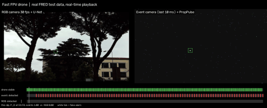</a>

Preview: the same real moments seen by an RGB camera with a trained AI detector (left) and by an event camera with PropPulse (right). <a href="https://cweekiat.github.io/dense-cuas/#video">Watch the full demo</a> · <a href="https://cweekiat.github.io/dense-cuas/site/assets/scenario_demo.mp4">open the video file</a>

---

## The idea in one picture

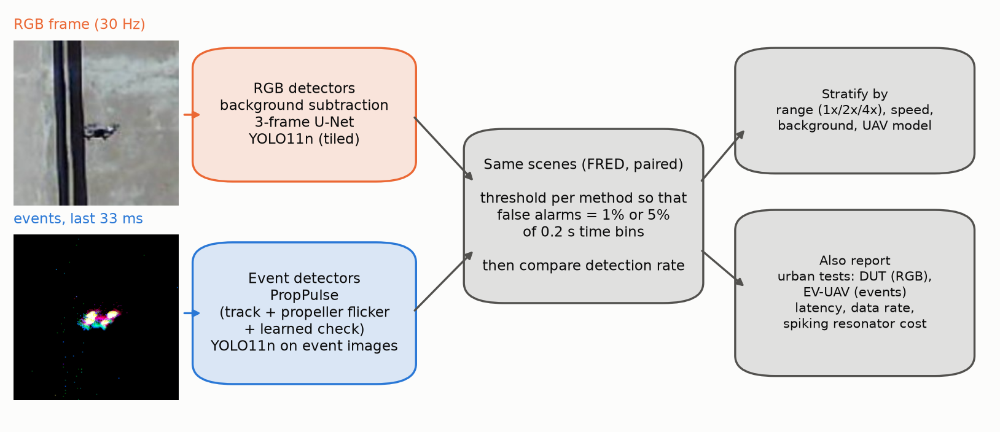

- **An event camera** reports per-pixel brightness *changes* with microsecond timing instead of full frames. Still buildings send nothing, fast motion does not blur, and spinning propellers flicker at a measurable rhythm.
- **PropPulse** tracks moving event clusters, cancels the drone's own motion, listens for the propeller's blade-pass rhythm (with a frequency analysis and a bank of spiking resonator neurons that react to every event), and lets a small trained classifier decide.
- **The fair race:** both cameras recorded the *same* scenes (the public FRED dataset). Every detector gets its own threshold so that all make the **same number of false alarms**; only then are detection rates compared.

## Results at a glance

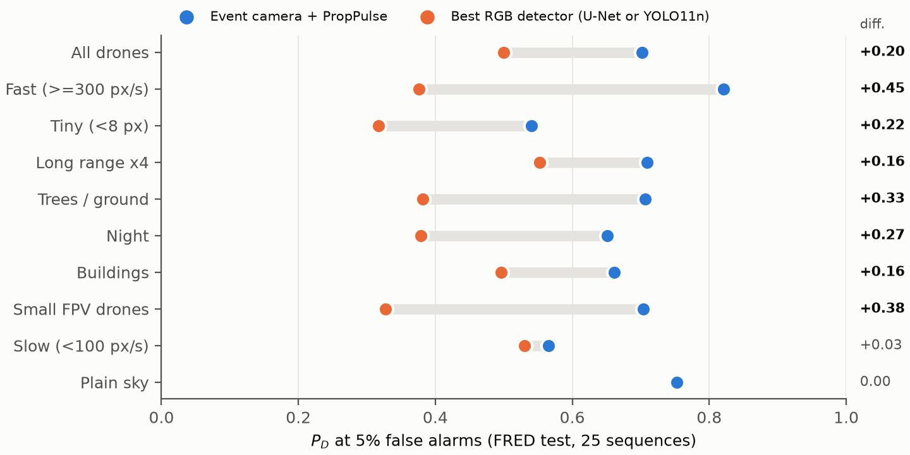

| Detector (25 held-out test recordings) | Detected at 1% false alarms | Detected at 5% false alarms [95% CI] |
|---|---|---|
| **Event camera + PropPulse** | **0.32** | **0.70** [0.64–0.76] |
| Event camera + YOLO11n | 0.22 | 0.49 [0.40–0.58] |
| RGB camera + U-Net | 0.31 | 0.50 [0.41–0.60] |
| RGB camera + YOLO11n | 0.29 | 0.44 [0.35–0.54] |
| RGB background subtraction | 0.01 | 0.06 [0.02–0.10] |

- **Overall:** at 5% false alarms, events find significantly more drones than RGB: +0.20 [0.12, 0.28] vs U-Net and +0.26 [0.15, 0.37] vs YOLO, as paired per-recording differences. At a stricter 1% neither side wins (0.32 vs 0.31 and 0.29).
- **Where events win:**
  - fast drones: 0.82 vs 0.38;
  - tiny targets (<8 px): 0.54 vs 0.32;
  - small FPV racers: 0.70 vs 0.33;
  - trees and ground clutter: 0.71 vs 0.38;
  - night: 0.65 vs 0.38.
- **Where they draw:** slow drones (0.57 vs 0.53) and plain sky (0.75 vs 0.75). RGB still wins against plain sky at the strict 1% setting.
- **Speed to first detection:** PropPulse spots 62% of drones within a quarter of a second (median 120 ms), against 50% for RGB YOLO (median 33 ms).

### Where each sensor is better

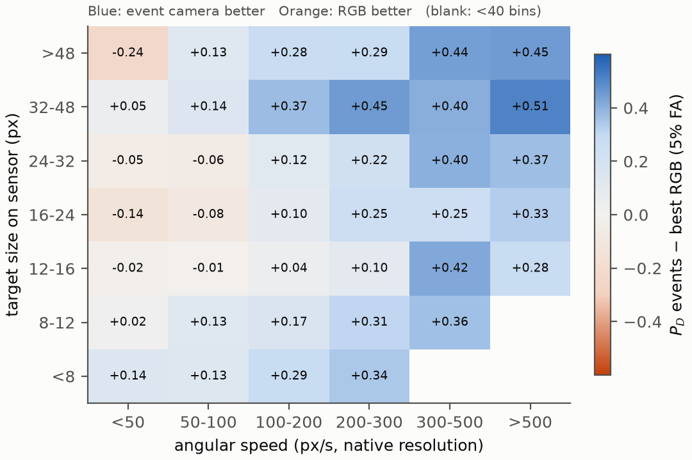

Blue cells mark where the event camera detects more drones than the best RGB detector, by target speed (x) and apparent size (y). Orange cells mark where RGB is better.

## Scenario by scenario (real test recordings, real-time playback)

Left: RGB camera + U-Net. Right: event camera + PropPulse. Green box: true drone; red box: detection; white: false alarm. The bars underneath show when each method fired. Clips were chosen to illustrate each scenario; the numbers above are over all test recordings.

| Fast FPV drone | Against buildings |
|---|---|
| 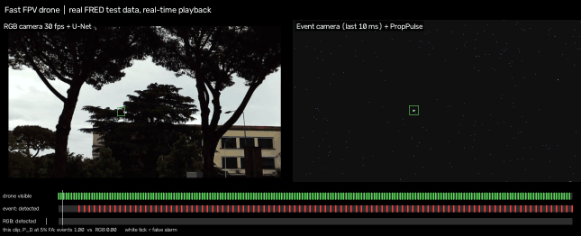 | 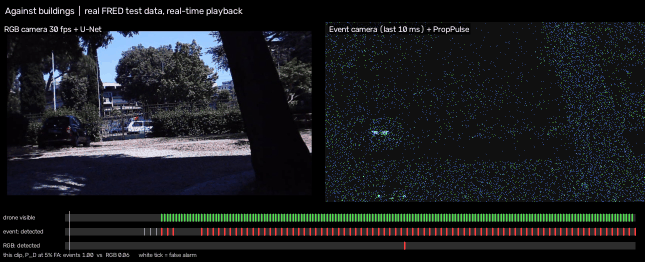 |
| **Trees and ground clutter** | **Night** |
| 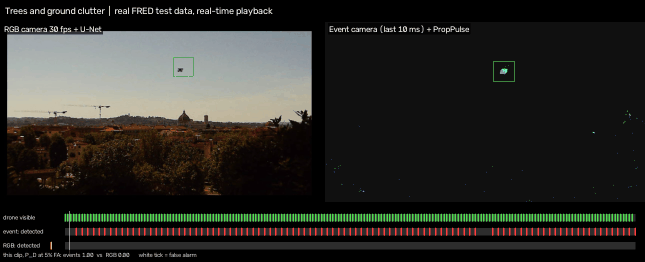 | 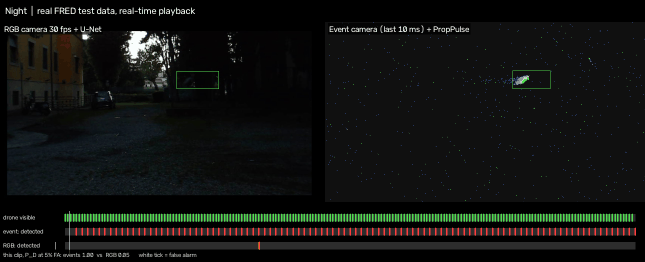 |
| **Long range (emulated 4×)** | **Where RGB wins: slow drone, plain sky** |
| 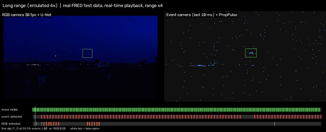 | 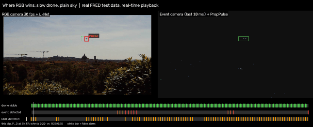 |

<b>Side-by-side stills for every scenario</b>

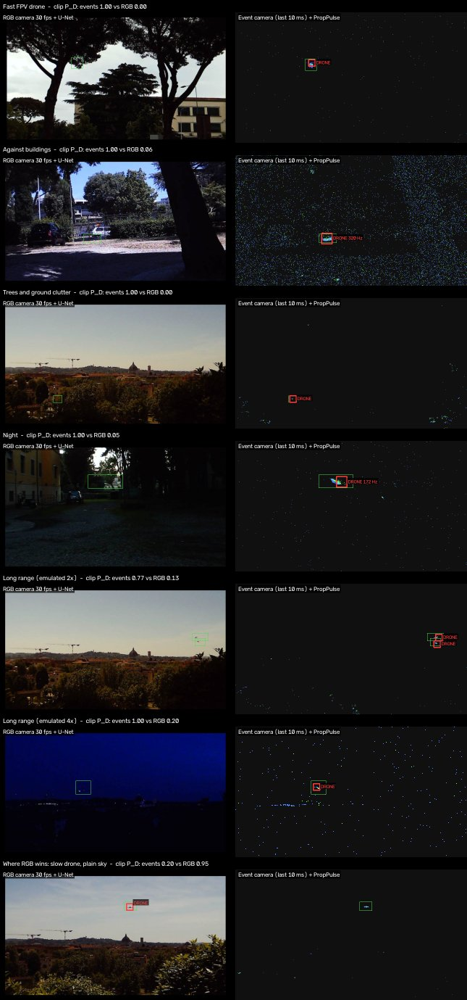

## How PropPulse finds a propeller

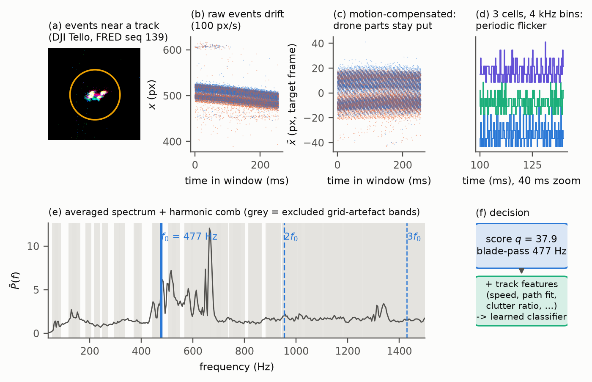

Spinning blades make the pixels they sweep flicker hundreds of times a second. Each drone model has its own blade-pass frequency, from about 220 Hz (DJI Mini 3) to 740 Hz (BetaFPV Air75). The method keeps the drone still by cancelling its motion, then looks for that rhythm and its harmonics.

## More results

| | |
|---|---|
| 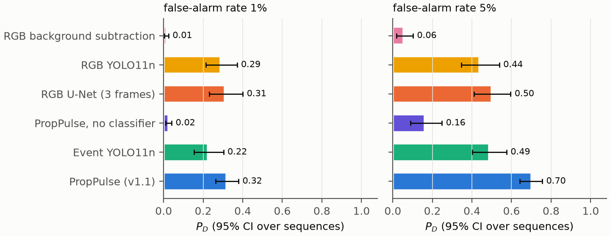 | 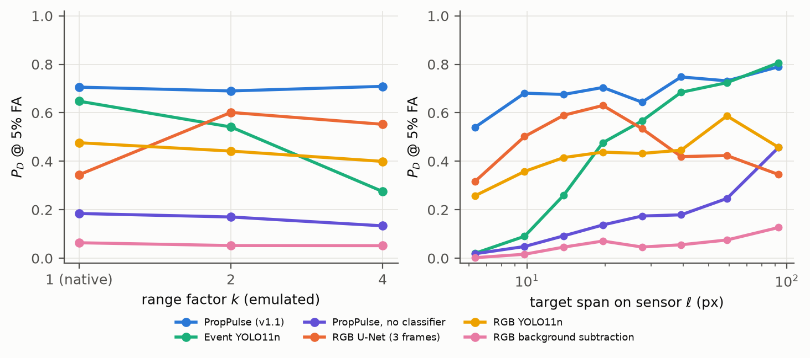 |
| Detection rate with 95% CIs at 1% and 5% false alarms | Detection vs emulated range and target size |
| 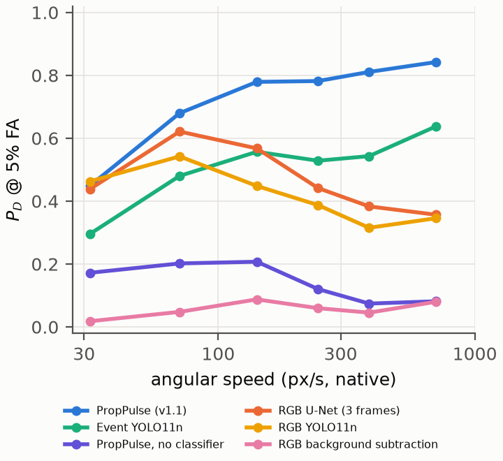 | 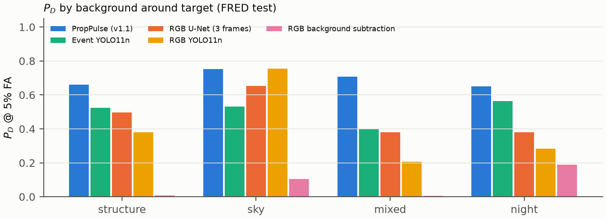 |
| Detection vs drone speed | Detection by background |

**Spiking neurons.** A bank of 48 resonate-and-fire neurons separates drone from non-drone windows about as well as the spectral check (AUC 0.68 vs 0.69). On drones it fires after a median of 37 ms instead of 210 ms, with about 19× fewer operations. In the final detector every track runs its own bank on every incoming event, and the neurons' responses help the classifier decide. The operation count is an estimate; energy was not measured.

**Compute.** On one laptop CPU core, PropPulse needs 0.10 s of processing per second of sensor data for a typical recording (median) and 1.4 s for the busiest 10%. Spread over four cores, 90% of recordings are processed faster than real time. A scene in which most of the image sways with the camera mount remains about 5× slower than real time.

All tables are in [`RESULTS.md`](RESULTS.md); aggregated metrics are in [`results/metrics.json`](results/metrics.json).

## Limitations

- **Scope:** one paired dataset, with one city, five drone models and a static camera.
- **Thresholds and range:** thresholds were set on test-clip false alarms, and range was emulated by image binning.
- **False alarms:** measured only within clips that contain drones.
- **Latency:** PropPulse's median time to first detection (120 ms) is still above YOLO's single frame (33 ms).
- **Other sensors:** PropPulse's classifier needs some training data from a new sensor; on the low-resolution EV-UAV recordings it reaches 0.53 at 5% false alarms with EV-UAV training data and 0.13 without.
- **Not a deployable system:** a 5% bin false-alarm rate is far from operational requirements. These results rank sensing approaches.

## Repository contents

| Path | Content |
|---|---|
| `docs/` | Project web page (GitHub Pages) with the demo video |
| `assets/` | README animations and stills |
| `RESULTS.md` | Result tables |
| `results/` | Aggregated metrics and figures |

Source code, pipelines, trained models, weights and data are **not** public.

## Licence and use

Copyright © 2026 the author. All content (text, figures, videos, animations, metrics) is licensed under **[CC BY-NC-ND 4.0](https://creativecommons.org/licenses/by-nc-nd/4.0/)** ([`LICENSE`](LICENSE)): attribution, non-commercial use only, and no modified versions.

**Responsible-use request:** this work is published for civil-safety and academic research on drone detection. The author does not consent to its use in weapons, targeting systems, or surveillance of people. This request accompanies the licence and does not replace it.

## Data acknowledgements

Figures, videos and animations use imagery from these public datasets, under their terms:
- **FRED**, the Florence RGB-Event Drone Dataset (Apache-2.0);
- **DUT Anti-UAV** (Apache-2.0);
- **EV-UAV** (non-commercial use, with acknowledgement).

The work builds on prior propeller-sensing research, including the event-camera drone fence of Stewart et al., the propeller detector of Špetlík et al., EventRadar, EvDetMAV and EVPropNet.

## Citation

> DENSE-CUAS (2026). *Event camera vs RGB + AI for small-drone detection: a paired, matched-false-alarm evaluation.* https://cweekiat.github.io/dense-cuas/
